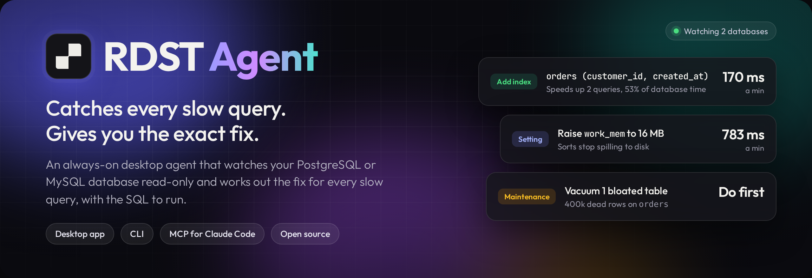
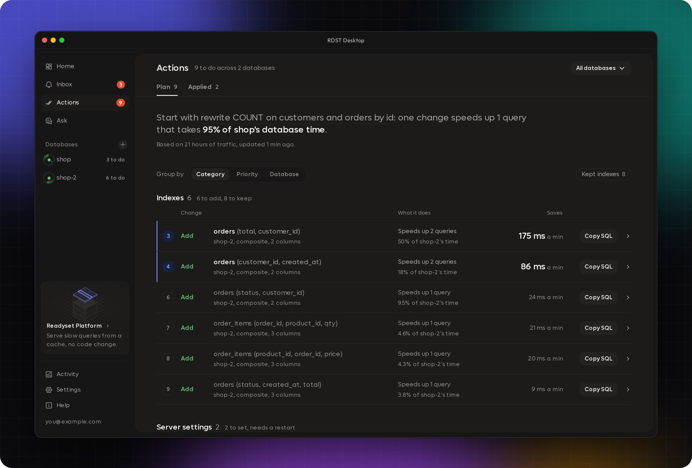
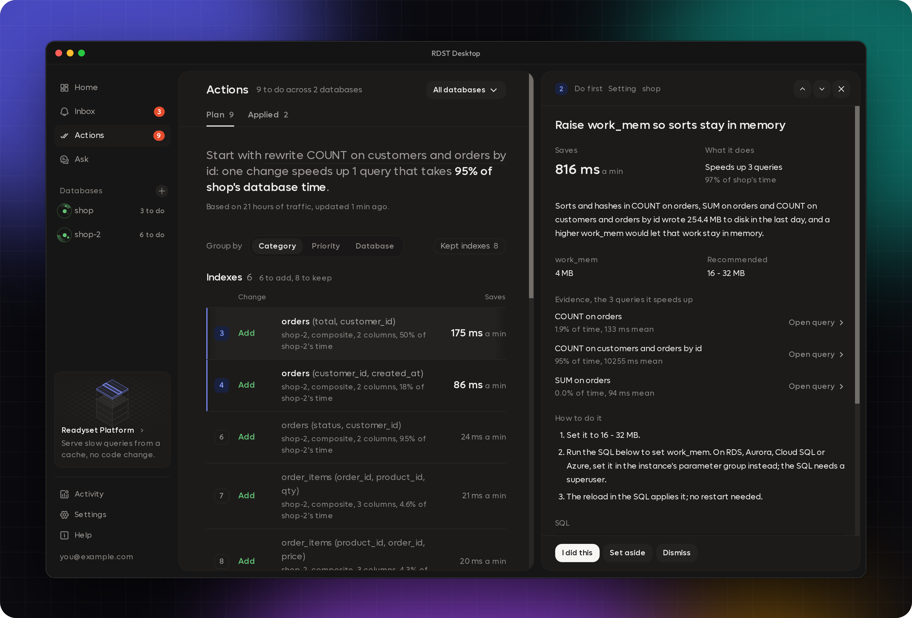

<p align="center">
  
</p>

<p align="center">
  <a href="https://pypi.org/project/rdst/"></a>
  <a href="LICENSE"></a>
  <a href="https://readyset.io/docs/readyset-ai/rdst"></a>
</p>

<p align="center">
  <a href="https://readyset.io/downloads"></a>
  <a href="https://readyset.io/downloads"></a>
  <a href="https://readyset.io/downloads"></a>
</p>

<p align="center">
  <b>RDST Agent</b> is an always-on agent that catches every slow query on your PostgreSQL or MySQL database and gives you the exact fix. It runs on your machine, connects read-only, and keeps a ranked plan of what to do: the index to add, the index to drop, the setting to change, the query to rewrite.
</p>

<p align="center">
  
</p>

## What it does

- **Watches every query.** The agent reads your database's own query statistics every minute,
  so it sees the queries your app actually runs, with no proxy and no code change.
- **Finds what's costing you.** It ranks queries by their share of database time and flags the
  ones that got slower, spiked or stopped running.
- **Works out the fix.** For the queries that matter, it runs `EXPLAIN`, reads the plan and the
  schema, and decides what would help: a missing index, a server setting, a rewrite, or a
  vacuum.

### Every fix shows its work

Each change comes with the time it saves, the queries it speeds up, step-by-step instructions for
your own server or RDS, Aurora, Cloud SQL and Azure, and SQL you can copy, with the SQL to undo it
where one applies.

<p align="center">
  
</p>

## How it works

1. **Install the desktop app** and add a database. Use a read-only user; RDST gives you the SQL to
   create one.
2. **Turn on RDST Agent.** It starts reading `pg_stat_statements` on PostgreSQL or
   `performance_schema` on MySQL, and your first plan shows up within minutes.
3. **Work the plan.** Start at the top, copy the SQL, and mark changes done. The agent checks that
   each one helped.

RDST never writes to your database. Your monitoring history, reports and settings stay on your
machine, and passwords live in your operating system's credential store. AI features send SQL
text, plans and schema, never the rows in your tables.
[Read how RDST handles your data](https://readyset.io/docs/readyset-ai/rdst/desktop/privacy).

## What's in this repository

| | |
| --- | --- |
| `cli/` | The `rdst` Python CLI, and the HTTP API the UI talks to |
| `web/` | The browser UI, served by `rdst web` and embedded in the desktop app |
| `desktop/` | The Electron shell that ships the CLI as a local sidecar |
| `packages/` | The shared design system: `ui-new`, `ui-icons`, `tailwind-base`, `typescript-config` |

## Build from source

You'll need Node 22+ and pnpm 11 for the JavaScript side, and Python 3.10+ with
[uv](https://docs.astral.sh/uv/) for the CLI.

```bash
pnpm install
pnpm build                          # web bundle + desktop main process
pnpm --filter rdst-web dev          # the UI and a reloading `rdst web` backend
pnpm --filter rdst-desktop dev      # the same, inside the Electron shell
pnpm --filter rdst-web dev:vite     # the UI alone, against a running `rdst web`
```

Both `dev` launchers start the CLI out of `cli/` with `uv`, so they need `uv` on PATH and an
interpreter whose bundled SQLite is new enough to be WAL-safe. When none is, they list the
interpreters they tried. The desktop sidecar build, `pnpm --filter rdst-desktop build:sidecar`,
freezes `cli/` into a PyInstaller bundle the packaged app launches. It needs Python 3.12 and the
web bundle built first (`pnpm --filter rdst-desktop build:web`).

The CLI is a standard Python project and builds on its own. See [`cli/README.md`](cli/README.md)
for its toolchain.

## Community builds

Builds from this source use open fonts and icons: Outfit for the UI face and the Hugeicons free
set for the icons, matched closely enough that layout and spacing don't change. See
[`LICENSE-THIRD-PARTY`](LICENSE-THIRD-PARTY).

Product analytics are compiled out unless a key is supplied at build time, so a build from this
source reports nothing. Desktop builds from this source have auto-update switched off.

## Contributing

Pull requests are welcome. See [`CONTRIBUTING.md`](CONTRIBUTING.md) for how they land.

## License

Apache 2.0. See [`LICENSE`](LICENSE). Third-party fonts and icons keep their own licenses, listed
in [`LICENSE-THIRD-PARTY`](LICENSE-THIRD-PARTY).

## CLI

On macOS or Linux, with no sudo, pip or preinstalled Python:

```bash
curl -fsSL https://downloads.readyset.io/packages/rdst-cli/install.sh | sh
```

It's also on PyPI, or you can install it straight from this repository:

```bash
pip install rdst
pip install "git+https://github.com/readysettech/rdst.git#subdirectory=cli"
```

Then point it at a database:

```bash
rdst init          # guided setup for your first Postgres or MySQL target
rdst top           # live view of the slowest queries hitting it
rdst analyze       # why a query is slow, and what an index or cache would do
rdst web           # the full RDST UI in your browser
rdst claude add    # register RDST as an MCP server for Claude Code
```

Full documentation lives at [readyset.io/docs](https://readyset.io/docs/readyset-ai/rdst).
