# RDST web and desktop UX map

How every screen in the RDST app connects: routes, gates, states, and the
transitions between them. The web app (`rdst web`) and the desktop app share
one React frontend (`web-apps/apps/rdst/src`) and one FastAPI backend
(`rdst/shared/api`, `rdst/features/*/api`); the desktop app adds an Electron
shell (`web-apps/apps/rdst-desktop/src`) around them.

Built from the code in this checkout and organized by the relentless tester
areas. UI text is quoted as it appears, except that non-ASCII punctuation
(dashes, arrows, ellipses) is written in ASCII. `X` stands for a database
name, `N` for a number. Scope is everything reachable from the app's
navigation. The Database page (`/database`) and its full analysis
(`/results`) belong to the monitoring area. `/cache` (Benchmarks) is reached
only from Activity benchmark rows and a `/results` error recovery; `/schema`,
`/scan` and `/guards` are effectively unlinked and appear only in the
appendix.

Contents:

1. System overview
2. How areas hand off to each other
3. Area graphs
   - 3.1 Adding a database (onboarding-connect)
   - 3.2 Settings (settings-targets)
   - 3.3 Home (home)
   - 3.4 AI gate and account sign-in (ai-access)
   - 3.5 Ask (ask)
   - 3.6 Actions (actions)
   - 3.7 Readyset Platform (platform)
   - 3.8 Activity and background runs (activity)
   - 3.9 Shell chrome (shell-navigation)
   - 3.10 Reloads, restarts, lost backend (app-lifecycle)
   - 3.11 Desktop shell (desktop-shell)
   - 3.12 Database page and monitoring (monitoring)
   - 3.13 Inbox (inbox)
4. Routes and parameters
5. Gates
6. State: where it lives and what survives
7. Navigation edges (reference)
8. Problems found
9. Dead or unreachable UI
10. E2E coverage by area
11. Appendix: pages not linked in the app

---

## 1. System overview

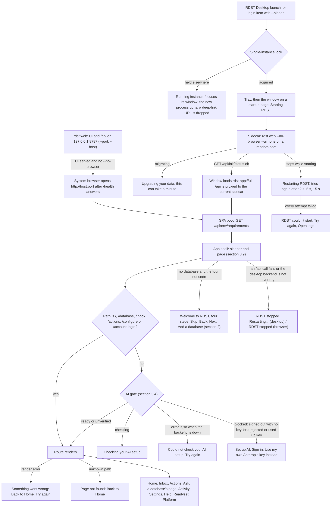

AI comes from a free Readyset account or from the user's own Anthropic key.
A new install opens on Home, which is never gated, with the Get started
steps and the first-run tour. Browser automation skips the tour unless a run
opts in; the desktop app shows it. Signed out with no key, Ask, `/results`,
Activity, Readyset Platform and Help show the gate as `blocked missing`. The
AI gate stands in for a page inside the shell; the sidebar stays usable.
Home, database pages, Inbox, Actions and Settings are never gated, so adding
a database, the tour and local monitoring work signed out; turning on
monitoring is where a signed-out user is asked to sign in (section 3.12).
There is no no-targets lockout: pages without a database show "No database
yet" with "Add a database".

## 2. How areas hand off to each other

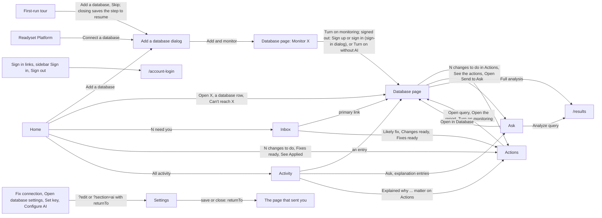

Recovery links that carry `returnTo` (Ask, the password and connectivity
notices, `/results`) send the user back after a save or close. Links without
it (Home's "Fix connection", Inbox items, the monitoring pane's "Connection")
land on `/configure?panel=connections` instead. One global selection drives
the Database page and the sidebar's active row; Home, Ask, Actions and the
Inbox each keep their own `?db=` filter.

---

## 3. Area graphs

### 3.1 Adding a database (onboarding-connect)

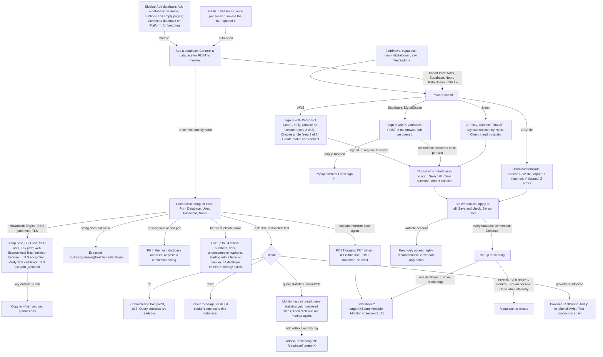

The dialog is mounted at the root, so `?add=` opens it on any page; closing
it drops `add`. "Add and monitor" refuses to add while query statistics are
unreadable. The manual flow shows no toast and no writable-account review;
only provider imports show the read-only notice. Imports do not set a default
database or start bootstrap. Azure and GCP are not offered. Edit mode reuses
the form as "Edit database" (section 3.2).

Prerequisite checks (`GET /api/configure/targets/{name}/prerequisites`, polled
every few seconds) back both the import's monitoring step and the turn-on
dialog: "Checking X", "Can't reach X", "One fix needed" / "N fixes needed",
"Monitoring can start", "Ready to monitor"; each check is Passed, Needs a fix,
Recommended, Waiting or Not checked, with "Show how to fix". PostgreSQL checks
`pg_stat_statements` loading and creation, read permission, full query text
and a live probe; MySQL checks `performance_schema`, its permission, digest
collection, history and digest length, and a live probe.

### 3.2 Settings (settings-targets)

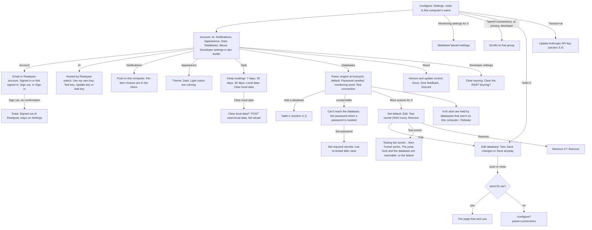

Reachability is swept once per visit; there is no "Check all" and no target
groups. "Remove" deletes the database's readings, Inbox items, actions and
reports ("Adding it back starts fresh."). The edit dialog has no Cancel button
and locks no field; a rename moves the selection. "Keep readings" is stored in
preferences (`keep_readings_days`), but the Database page's monitoring pane
shows a fixed "7 days". `?from=fleet` and `?from=dev-settings` are accepted
and show nothing. Clearing local data also removes stored RDST keys and
reloads to a fresh install.

### 3.3 Home (home)

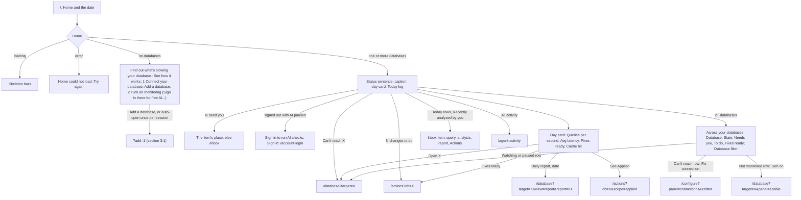

The status sentence picks the first that applies: "N need you on X", "Can't
reach X since ...; no readings or alerts until it answers.", "N changes to
do", "All quiet on X since ...", the paused line ("charts and stuck-query
alerts running; AI checks paused since ..."), then "X: not monitored." The
caption reads "Watching N of M databases. Last reading ... Next report at
...". Get started has two steps, and Home only reaches the first, "Connect
your database"; the add-database dialog shows getting-started progress as
step 1 of 2, and turning on monitoring for the only database shows step 2 of
2. Once a database exists Home shows the status view, so an unmonitored single
database gets "X: not monitored." and no turn-on button on Home. `?db=`
narrows the day card and the Today log, not the strip; it is remembered in
localStorage `rdst_filter_db:home`. Signing in happens when turning on
monitoring (section 3.12) or from any Sign in link (section 3.4).

### 3.4 AI gate and account sign-in (ai-access)

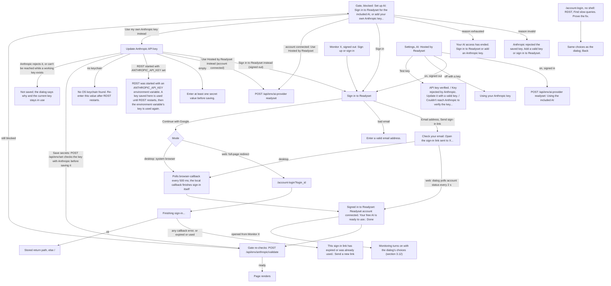

Gate states, in order: `error` (the requirements query failed), `checking`,
`blocked missing` (signed out with no key), `ready` for a Readyset account,
then the key probe: valid is `ready`, a provider error is `unverified` (let
through with no badge), anything else `blocked invalid`. The sign-in dialog
and `/account-login` read "A Readyset account is free and comes with AI for
monitoring, analyses, checks and Ask." Only Settings' "Hosted by Readyset"
switches the provider to Readyset; signing in from the gate, `/account-login`,
banners, Platform or monitoring does not, so a gate blocked as "invalid" with
the Anthropic provider stays blocked after sign-in. Saving a key forces the
Anthropic provider and replaces any saved key without checking it. Sign-out
(sidebar or Settings) has no confirmation; with the Readyset provider the gate
then shows the blocked page with no alert. While the gate shows, the add
dialog host and page notices are not mounted.

### 3.5 Ask (ask)

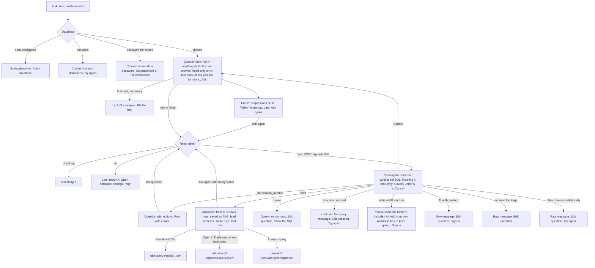

The database is `?db=`, else the remembered `rdst_filter_db:ask`, else the
first monitored database, else the global selection. `?sql=` and `?params=`
(from the Database page's "Send to Ask") prefill the question with
parameters filled in; they are not run as SQL and are removed on the first
submit. Clarifications offer radio options only: no free-text answer and no
skip. Cancel returns to the box with no message. History is backend-owned
(`GET /api/ask/history`); the shown answer, clarification and error are
memory-only. `?from=agents` (from `/agents`) shows nothing. A running answer
does not lock database switching; switching drops the run.

### 3.6 Actions (actions)

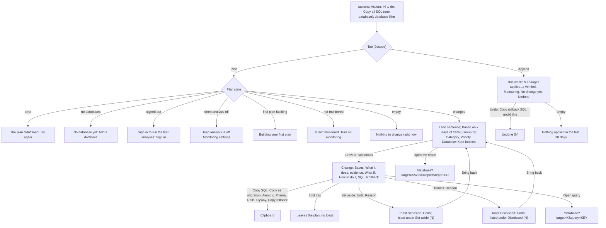

Nothing on the page changes a database: "I did this" and "I undid this" only
report what the user ran. Verbs go to `POST
/api/monitor/targets/{t}/actions/{id}/{did_it|set_aside|dismiss|bring_back|undid_it}`.
Opening the page posts `actions/opened`, which closes the Inbox's "Changes
ready" item. Set aside always carries a date (prefilled a week out). `?kind=`
narrows by kind with a clearable chip, but no link sets it. `?group=` is
remembered in `rdst_actions_group`, `?db=` in `rdst_filter_db:actions`. There
is no unreachable-database state. Risk, effort and confidence come from the
API but are not shown.

### 3.7 Readyset Platform (platform)

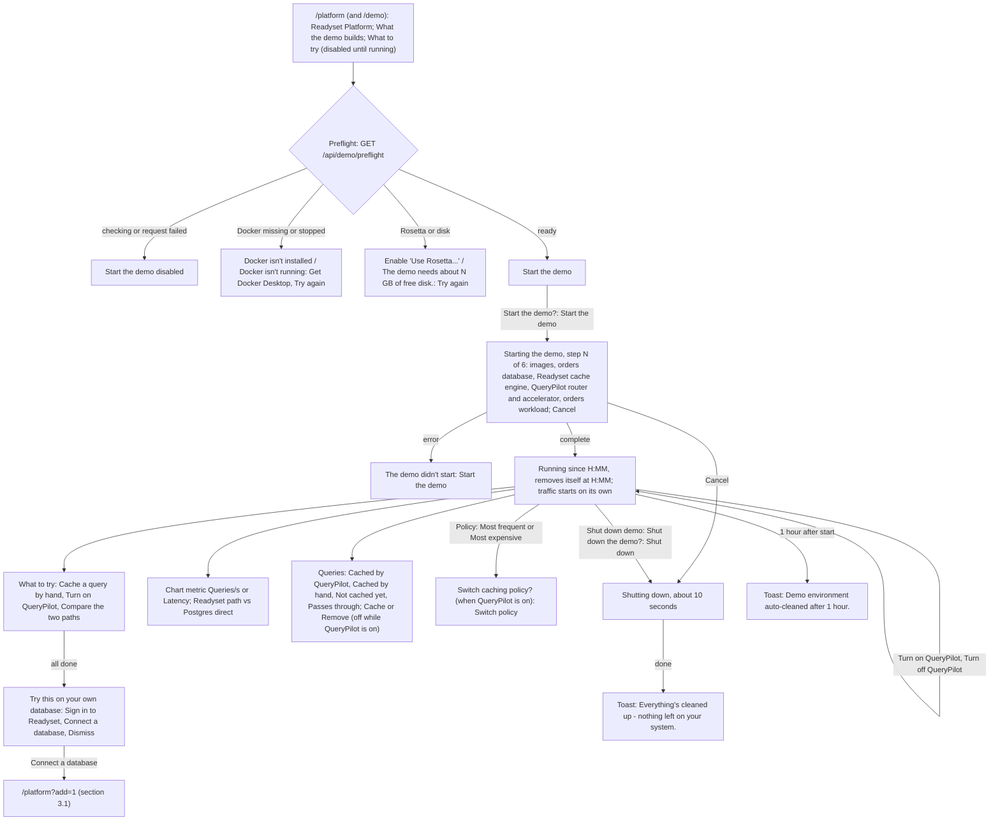

Provisioning progress lives in a module store, so navigating within the app
keeps it; a reload shows idle until the backend reports the demo provisioned,
with no reattach to the running provision. The demo's ports and auto-teardown
time are saved under `~/.rdst`, so a running demo survives a restart; load
history is memory-only. The page is behind the AI gate. Shutdown also deletes
the demo images, although the copy says they stay.

### 3.8 Activity and background runs (activity)

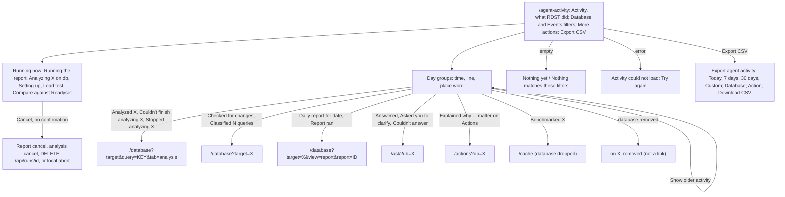

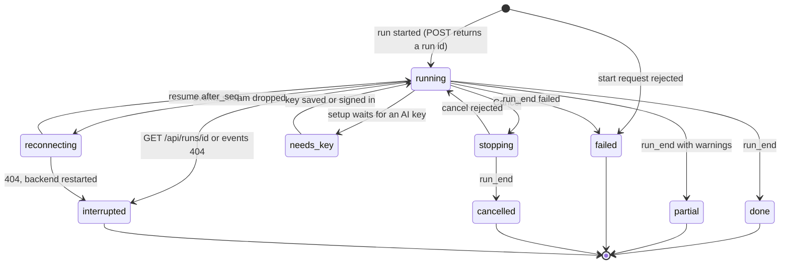

The old Jobs popover and Agent audit page are gone: Running now and the
sidebar's Activity count replace the first, the log the second. Running now
shows only active runs; finished, failed and interrupted runs appear nowhere,
and `needs_key` runs drop out. Server runs are kept in localStorage
`rdst_background_runs` and reattach once per app start. `?range` (today, 7d,
30d; default 7d) has no on-page control; the list states "Kept N days." from
the API. Rows have no detail view. A cancelled report or Ask reads as
"Couldn't finish" / "Couldn't answer".

### 3.9 Shell chrome (shell-navigation)

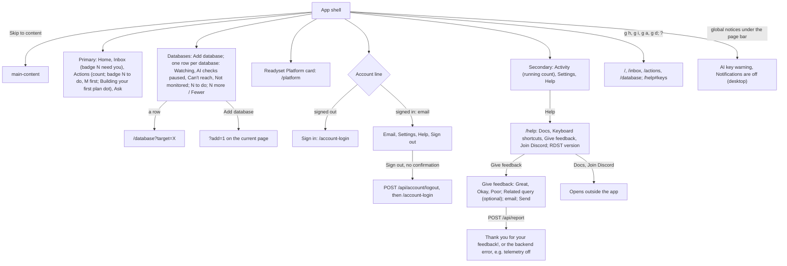

There is no global header, breadcrumb or narrow-window drawer: each page has
its own page bar, and the sidebar is a fixed 232 px column. The only crumbs
are on `/results` ("X / Queries / Full analysis"). On desktop the OS draws the
window controls through Electron's title bar overlay. The AI key warning
("Sign in to Readyset for the included AI, or add your own Anthropic API
key.": Sign in to Readyset, Set API key, Hide) shows on pages such as
Settings, Actions and Ask, never on Home, the Database page, Inbox or
Activity.
Help lists "Search /", which only the Database page binds. Feedback is sent as
a telemetry event; with telemetry off the backend returns "Feedback isn't sent
while telemetry is turned off." and the dialog shows it as an error.

### 3.10 Reloads, restarts, lost backend (app-lifecycle)

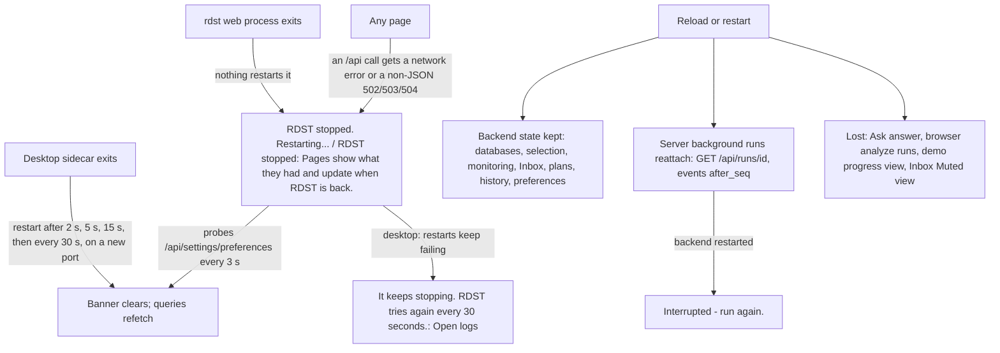

Monitoring, reports and analyses queued by monitoring run in the backend on
its schedule, with or without a page open. A browser-owned analysis
(`POST /api/analyze` on `/results`) dies with the page; nothing promises that
a run survives a backend restart. While the backend is down, React Query stays
paused, so pages keep their last data. The AI gate's error state still blames
"Could not check your AI setup" when it is the backend that is gone.

### 3.11 Desktop shell (desktop-shell)

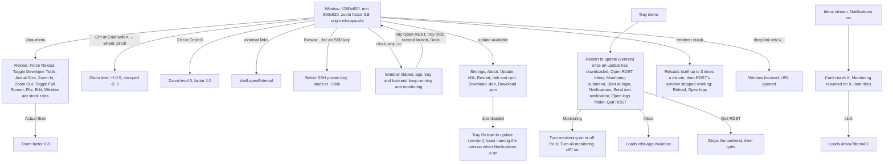

The origin is the same on every launch, so localStorage survives restarts;
only the backend port changes, behind the protocol handler. The tray icon
polls the open Inbox every 15 s and shows a red dot for items that need the
user; its menu re-reads the databases when it opens. Two notification
switches exist: the tray's "Notifications" (main-process toasts from the
Inbox stream) and Settings' "Push to this computer" (renderer toasts); with
both on, one alert can raise two toasts. When the OS blocks notifications the
app shows "Notifications are off" with "Turn on notifications" and "Hide", and
the tray adds a "Fix" item. Provider OAuth returns through `rdst://`
(`rdst-staging://`, `rdst-cl://`, or `rdst-dev://` unpackaged), which only
focuses the window; the renderer finishes by polling. Auto-update checks 15 s
after launch and every 6 h; errors are only logged.

### 3.12 Database page and monitoring (monitoring)

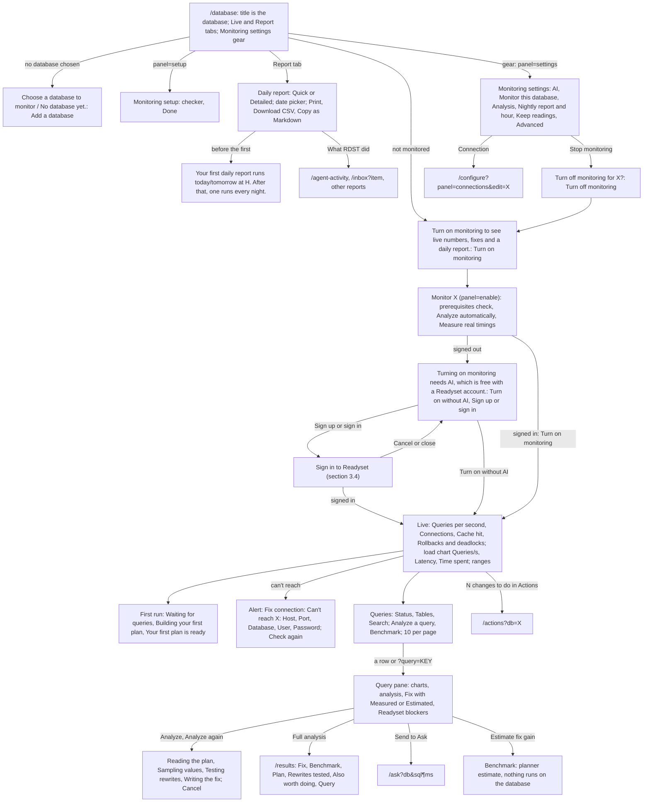

Monitoring runs on the backend schedule. Signed out, it charts and raises
connection and stuck-query alerts, and Actions lists server settings,
maintenance and indexes to drop; deep analysis, new indexes and query rewrites
need a Readyset sign-in, even with an Anthropic key. Signed out, the enable dialog adds
"Turning on monitoring needs AI, which is free with a Readyset account." and
"Without AI, RDST still charts query stats, alerts on connection problems,
and lists server settings, maintenance and indexes to drop on Actions. Deep
analysis, new indexes, query rewrites and nightly reports need AI."; "Sign up or sign in"
opens the sign-in dialog and turns monitoring on, with the dialog's choices,
once the sign-in finishes; "Turn on without AI" is the small ghost button.
Both wait for the prerequisites check. When a coding agent asks for the
turn-on, the dialog shows "Your turn: read and click Sign up or sign in" (or
"Turn on monitoring" when signed in). The enable dialog has no "Not now";
closing it leaves monitoring off. Reports come
only from the nightly schedule; nothing in the app runs one on demand.
Turning monitoring off keeps history. `target` on the URL selects the database
and is stripped; `view=actions|indexes` redirects to `/actions`. Several
parameters other pages send are parsed and ignored (section 8.2).
`/api/monitor/targets/{t}/settings`, `/health`, `/queries`, `/pulse` and
`/analyze-jobs` corroborate the page.

### 3.13 Inbox (inbox)

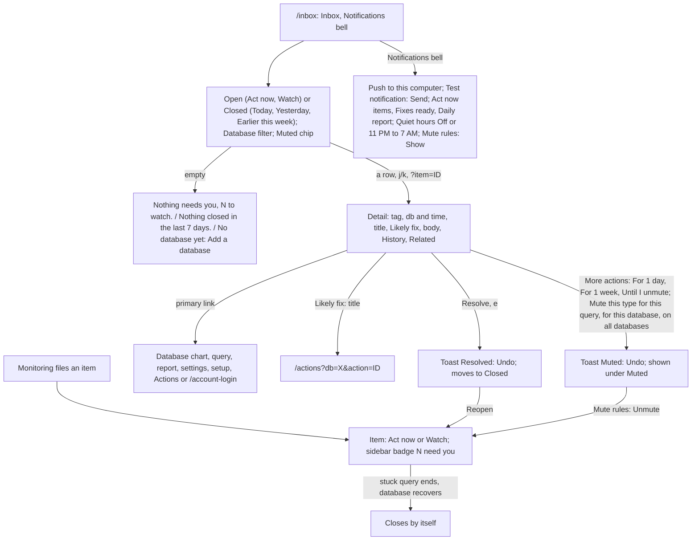

Item bodies exist for stuck queries ("What to do", "Closes by itself when the
statement ends."), changes ready ("Opening Actions for X closes this item."),
no change yet, report ready and fix confirmed; outages and regressions use the
generic body. There is no snooze, dismiss, recovered section or unread count
in the UI. Closed items stay 7 days. Notification choices apply to one
database (the filter, the global selection, or the first) without naming it.
Desktop pushes come from the Inbox stream's `notified` events and open
`/inbox?item=ID`. `/api/monitor/inbox` and `/api/monitor/mute-rules`
corroborate the page.

## 4. Routes and parameters

| Route | In nav | Parameters and notes |
|---|---|---|
| `/` | Home | `db`; `add` (any page) opens the add dialog |
| `/inbox` | Inbox | `state` (open default, `closed`; legacy `act_now`, `watch` land on Open), `db`, legacy `target`, `item` |
| `/actions` | Actions | `db`, `scope` (plan, applied), `kind` (index, setting, maintenance, rewrite, caching), `group` (category, priority, database), `action` |
| `/ask` | Ask | `db`, `sql`, `params`, `from=agents` |
| `/database` | a database row; `g d` | `target` (selects, then stripped), `view` (live or queries, report; actions and indexes go to `/actions`), `panel` (settings, setup, enable, analyze, benchmark), `range` (15m, 1h, 24h, 7d, 30d, all), `metric` (calls, latency, time), `health` (connections, hit, rollback), `query`, `status`, `table`, `q`, `report`, `zoom`; ignored: `focus`, `queries`, `from`, `jev`, `sort`, `filter`, `tab`, `action` |
| `/results` | no; Full analysis, Analyze query | `query`, `target`, `hash`, `key`, `analysisId`, `params`, `fast`, `origin`; bare `/results` goes to `/database` |
| `/agent-activity` | Activity | `target`, `action` (deep_analysis, ask, daily_snapshot, explain_actions, classification, attention_check, benchmark), `range` (today, 7d, 30d) |
| `/configure` | Settings | `panel` (connections, ai, privacy, developer), `section=ai`, `edit`, `returnTo`, `add`, `from`; hashes `#connections`, `#dev` |
| `/help` | Help | hash `#keys` |
| `/platform` | Readyset Platform card | |
| `/account-login` | Sign in | `login_id`; no shell; not gated |
| `/cache` | no | `view` (compare, load-test; quick goes to `/database`), `hash`, `run`; from Activity and `/results` recovery only |

Redirects: `/onboarding` to `/?add=1`; `/demo` to `/platform`; `/agents` to
`/ask?from=agents`; `/analyze`, `/queries`, `/top` to `/database`;
`/query-registry` to `/database` (`hash` becomes `focus`); `/audit` to
`/database?view=report`; `/db/$target` to `/database` for that target
(keeps `query`); `/db/$target/report` to `/database?view=report`;
`/database/reports/$reportId` to `/database?view=report&report=ID`;
`/benchmark` to `/cache?view=load-test`; `/fleet` to
`/configure?add=...&from=fleet#connections`; `/dev-settings` to
`/configure?from=dev-settings#dev`.

## 5. Gates

| Gate | Source | Effect |
|---|---|---|
| AI access | `GET /api/env/requirements`, `POST /api/env/anthropic/validate` | On every path except `/`, `/database`, `/inbox`, `/actions`, `/configure`, `/account-login`, the page is replaced by the gate (section 3.4) |
| Readyset sign-in | `/api/account/status`, monitor settings `ai_reason` | Turning on monitoring signed out offers "Sign up or sign in" or "Turn on without AI". Deep analysis, the plan in Actions and written reports wait: "Sign in to run AI checks.", "Sign in to run the first analyses" |
| AI monitoring slots | `GET /api/monitor/limit` | A database beyond the account's slots monitors locally: "Make an AI slot available to turn on AI here" |
| Query statistics | `GET /api/configure/targets/{name}/prerequisites` | "Add and monitor" refuses; "Turn on monitoring" stays disabled until the check passes |
| Target password | `/api/status` `has_password` | Ask: "Connection needs a password"; Settings row: "Password needed" |
| Reachability | SSE `GET /api/fleet/status?targets=` | Before an Ask question: "Can't reach X" |
| EXPLAIN ANALYZE consent | `/results` | "Run EXPLAIN ANALYZE?" before Analyze again |
| Parameters | placeholders in SQL | Parameter dialog in "Analyze a query" and `/results` |
| Docker | `GET /api/demo/preflight` | Blocks "Start the demo" |
| Backend reachable | any `/api` failure, desktop backend state | Banner; pages keep their last data |

`useTargetSwitchLock` is still taken by Ask and analysis, but nothing reads
it, so no control is disabled.

## 6. State: where it lives and what survives

| State | Where | Reload | Desktop restart | Backend restart |
|---|---|---|---|---|
| Databases, default, monitor settings, readings, Inbox items, mute rules, plans, reports, activity log | `~/.rdst` config and backend stores | kept | kept | kept |
| Target passwords, Anthropic key | OS keychain, else backend memory (session only) | kept | keychain kept; session-only lost | keychain kept; session-only lost |
| AI provider, Readyset session | backend config `llm_provider`; keychain or a private file | kept | kept | kept |
| Preferences: selected database, push notifications, keep readings, report view | `GET/PUT /api/settings/preferences` | kept | kept | kept |
| Ask history, query registry, analyses | backend registry | kept | kept | kept |
| Demo ports, auto-teardown time, tour done | `~/.rdst` demo config | kept | kept | kept |
| Selected database (cache), per-page `?db` filters | localStorage `rdst_selected_target`, `rdst_filter_db:{home,ask,actions,inbox}` | kept | kept | kept |
| Actions grouping, report seen marks | localStorage `rdst_actions_group`, `rdst_report_seen:X`, `rdst_actions_seen` | kept | kept | kept |
| Push notifications (cache) | localStorage `rdst_inbox_desktop_notifications` | kept | kept | kept |
| Server background runs | localStorage `rdst_background_runs` | reattached | reattached | become interrupted |
| Sign-in return path, temporary Supabase session | localStorage `rdst_login_return_to`, `rdst-account-{login_id}` | kept until sign-in finishes | kept | kept |
| First-run popups shown, notifications banner hidden | sessionStorage `rdst_get_started_add-database`, `rdst_notifications_banner_hidden` | kept | lost | kept |
| Desktop zoom | Electron, per origin; window opens at 0.8 | kept | unverified | kept |
| Tray notifications, start at login | `desktop-settings.json` | kept | kept | kept |
| Ask answer and clarification, Inbox Muted view, AI warning Hide | memory | lost | lost | lost |
| Browser analyze run on `/results` | memory | lost (backend may finish it) | lost | lost |
| Demo provisioning progress | module memory; backend | lost (backend continues) | lost | lost |

The desktop origin `rdst-app://ui` is stable across launches, so localStorage
survives a desktop restart; the browser keeps its origin as long as the port
stays the same (8787 by default).

Streaming endpoints (SSE): `POST /api/ask`, `POST /api/analyze`,
`POST /api/configure/targets/{name}/test`, `GET /api/fleet/status`,
`POST /api/fleet/import`, `POST /api/demo/provision`,
`GET /api/demo/load/stream`, `GET /api/runs/{id}/events`,
`GET /api/monitor/inbox/stream` (also read by the desktop main process),
`GET /api/monitor/targets/{t}/stream`,
`GET /api/monitor/targets/{t}/report/{id}/events`, and
`GET /api/query-registry/discovery/stream` (EventSource, opened on every
page).

## 7. Navigation edges (reference)

Every in-app navigation, grouped by where it starts. Graphs above show these
in context; this table is the checklist.

| From | Trigger | To |
|---|---|---|
| any | sidebar Home, Inbox, Actions, Ask, Activity, Settings, Help | `/`, `/inbox`, `/actions`, `/ask`, `/agent-activity`, `/configure`, `/help` |
| any | a database row; Add database; Platform card | `/database?target=X`; current page `?add=1`; `/platform` |
| any | account "Sign in"; account menu Settings, Help, Sign out | `/account-login`; `/configure`, `/help`, `/account-login` |
| any | keys `g h`, `g i`, `g a`, `g d`, `?` | `/`, `/inbox`, `/actions`, `/database`, `/help#keys` |
| any | error boundary or 404 "Back to Home" | `/` |
| any | AI warning "Sign in to Readyset", "Set API key" | sign-in dialog, key dialog |
| AI gate | Sign in; Use my own Anthropic key instead | sign-in dialog; key dialog |
| First-run tour | Add a database; Skip | current page `?add=1` |
| Monitor X, signed out | Sign up or sign in; Turn on without AI | sign-in dialog, then monitoring on and `/database`; monitoring on and `/database` |
| `/account-login` | Back; signed in | history back or `/`; stored return path or `/` |
| Add dialog | Add and monitor; Add without monitoring | `/database?target=X&panel=enable`; `/database?target=X` |
| Add dialog | import Turn on monitoring; Done | `/database?panel=enable`; `/database` |
| Add dialog | allowlist "Connect X" | `/configure?add=X` |
| Home | needs-you link; Can't reach X; N changes to do | item's place or `/inbox`; `/database?target=X`; `/actions?db=X` |
| Home | Open X; Daily report; Fixes ready; See Applied | `/database?target=X`; `?view=report&report=ID`; `/actions?db=X`; `/actions?db=X&scope=applied` |
| Home | strip row; Fix connection; Turn on | `/database?target=X`; `/configure?panel=connections&edit=X`; `/database?target=X&panel=enable` |
| Home | Today rows; All activity; Sign in | inbox, query, analysis, report, actions targets; `/agent-activity`; `/account-login` |
| Inbox | primary link | `/database?target...` (query, report, `panel=settings`, `panel=setup`, `range`, `zoom`, `from`), `/configure?panel=connections&edit=X`, `/actions?db=X[&scope=applied]`, `/account-login` |
| Inbox | Likely fix; Fixes ready; Queries analyzed | `/actions?db=X&action=ID`; `/actions?db=X`; `/database?target=X` |
| Actions | Open query; Open the report; X is not monitored | `/database?target=X&query=KEY`; `?view=report&report=ID`; `/database?target=X` |
| Actions | Monitoring settings; Turn on monitoring; Sign in | `/database?target=X&panel=settings`; `?panel=enable`; `/account-login` |
| Ask | Open in Database; Analyze query | `/database?target=X&query=KEY`; `/results?query&target&origin=ask` |
| Ask | Open database settings; Fix connection; Sign in | `/configure?edit=X&returnTo`; same; `/account-login` |
| Database | N changes to do in Actions; See the actions; Open Actions | `/actions?db=X` |
| Database | Full analysis; Send to Ask | `/results?query&target&hash&key&analysisId`; `/ask?db&sql&params` |
| Database | Connection; Manage databases | `/configure?panel=connections[&edit=X]` |
| Database | report What RDST did; All reports | `/agent-activity`, `/inbox?item`, `/database?view=report&report`; `/agent-activity?target=X` |
| `/results` | crumbs; Benchmark; Send to Ask | `/database?target=X`, `?view=live`; `/database?query=KEY&panel=benchmark`; `/ask?db&sql` |
| `/results` | error recovery: Open settings, Open AI settings; Set up caching | `/configure`; `/cache` |
| Activity | entries | `/database?target...`, `/ask?db=X`, `/actions?db=X`, `/cache` |
| Settings | Monitoring settings for X; Sign in; Inbox link | `/database?panel=settings`; `/account-login`; `/inbox` |
| Settings | save or close with `returnTo`; without | the sending page; `/configure?panel=connections` or `?panel=ai` |
| Settings, Help | Docs, Discord | readyset.io/docs, discord.gg (outside the app) |
| Platform | Connect a database; Get Docker Desktop | `/platform?add=1`; docs.docker.com |
| Desktop tray | Open RDST; Inbox | the window; `rdst-app://ui/inbox` |
| Desktop toast | click | `/inbox?item=ID` |

## 8. Problems found

Fixes come later; this section keeps them documented. Sources: **run** =
seen by relentless agent runs against the real app; **code** = read in the
source, not reproduced; **tests** = contradiction inside the e2e suites.
Per-finding steps and evidence are under
`test-results/batch/<run>/build/<area>/findings/` (gitignored).

### 8.1 From runs

Seen in run main-2705 (staging 0.1.2705) or fixes-2757 (CL 0.1.2757),
2026-10-16. Many fixes-2757 findings have since been fixed in a stack not in
this checkout; treat these as leads to re-check, not as open bugs.

| Problem | Severity | Area | Run |
|---|---|---|---|
| Plan-only Full analysis is labeled Measured and exposes an unmeasured speedup as tested | P1 | monitoring | fixes-2757 |
| MySQL rewrite hard-codes a table sample instead of preserving the query parameter | P1 | monitoring | main-2705 |
| Reopening a recovered "Can't reach the database" alert rewrites the recorded outage end | P1 | inbox | fixes-2757 |
| Full analysis promotes a rewrite labeled Slower as the Fix | P2 | monitoring | fixes-2757 |
| Daily report promises a scheduled report when Nightly report is off | P2 | monitoring | main-2705 |
| Reloading a completed analysis silently runs a new paid analysis | P2 | app-lifecycle | main-2705 |
| Connection test stays on Connecting after a backend crash ends its stream | P2 | app-lifecycle | main-2705 |
| Monitoring "Keep readings" disagrees with the retention saved in Settings (30 days saved, 7 days shown) | P2, P3 | settings-targets, app-lifecycle | main-2705 |
| Double-clicking Add without monitoring saves the database but leaves the dialog showing a duplicate-name error | P2 | onboarding-connect | main-2705 |
| Non-ASCII Neon API key causes an internal server error | P2 | settings-targets | main-2705 |
| Non-ASCII Anthropic key is saved and its failure blamed on connectivity | P2 | ai-access | main-2705 |
| Signing in does not enable the included AI after a session-only key expires | P2 | ai-access | fixes-2757 |
| Ask again discards clarification choices and can change the ranking metric | P2 | ask | main-2705 |
| Ask follow-ups do not resolve against the preceding answer and drop its year and metric | P2 | ask | main-2705, fixes-2757 |
| A saved question keeps the earlier question's SQL | P2 | ask | fixes-2757 |
| Rapid Enter submissions leave a false database-unreachable error beside a good answer | P2 | ask | main-2705 |
| A backend crash leaves Ask's database query running after the UI reports failure | P2 | ask | main-2705 |
| Re-asking a PostgreSQL answer runs on MySQL after changing the page's database | P2 | ask | main-2705 |
| Home claims Readyset sign-in and included AI while a personal Anthropic key is in use | P2 | home | fixes-2757 |
| Copy as migration exports an unbound parameterized SELECT for application rewrites | P2 | actions | fixes-2757 |
| Reload or restart during provisioning shows an incomplete demo as Running and hides the router failure | P2 | platform | main-2705, fixes-2757 |
| Failed QueryPilot toggle is marked done with a false chart marker and no error | P2 | platform | main-2705 |
| Docker-ready demo never finishes provisioning: the Readyset snapshot times out | P2 | platform | fixes-2757 |
| Cancelled SELECT analyses are reported as skipped writes and schema changes, or as having run EXPLAIN ANALYZE | P2 | activity | main-2705, fixes-2757 |
| Restart-recovery failures disappear from Activity instead of being recorded | P2 | activity | fixes-2757 |
| Stuck query stays Act now after the statement has ended | P2 | inbox | main-2705 |
| "Can't reach the database" does not come back for later outages once resolved | P2 | inbox | main-2705 |
| Turning monitoring on from the tray leaves the Database page on Not monitored | P2 | desktop-shell | fixes-2757 |
| An invalid port is reported as missing host, database and user | P3 | onboarding-connect, settings-targets | main-2705 |
| MySQL query-statistics setup says to restart an already enabled performance_schema | P3 | onboarding-connect | main-2705 |
| A failed connection test gives no cause or recovery guidance | P3 | settings-targets | main-2705 |
| Offline Supabase sign-in or account sign-in shows a raw Python network exception | P3 | settings-targets, shell-navigation | main-2705, fixes-2757 |
| Home drops the getting-started guidance before monitoring is on | P3 | home | main-2705 |
| "Save securely" switch has no accessible name | P3 | ai-access | fixes-2757 |
| Clarification offers a custom year with no way to enter it | P3 | ask | fixes-2757 |
| Decade years are formatted as thousands | P3 | ask | main-2705 |
| Rewrite rationale keeps an old database-time share while the evidence updates | P3 | actions | fixes-2757 |
| Full analysis cuts "Also worth doing" off mid-word; a rewrite Fix is labeled "one index" with index-build steps | P3 | monitoring | main-2705 |
| Feedback Send silently does nothing with an invalid email | P3 | shell-navigation | main-2705 |
| An unreachable database still shows a green "RDST is gathering your queries." | P3 | app-lifecycle | fixes-2757 |
| Keyboard zoom shortcuts leave zoom unchanged while the menu's zoom works | P3 | desktop-shell | main-2705 |
| The first tray menu after turning monitoring on still offers to turn it on | P3 | desktop-shell | main-2705 |
| The connection editor opened from monitoring does not return there on close or save | P4 | settings-targets | fixes-2757 |
| `rdst://` deep links raise the window but ignore the destination | P4 | shell-navigation | main-2705, fixes-2757 |

main-2705's actions run was blocked: no plan appeared on the small fixture,
so most of the Actions brief went untested.

### 8.2 From code

| Problem |
|---|
| Only Settings' "Hosted by Readyset" switches the provider; every other sign-in leaves an "invalid" gate blocked |
| Saving an Anthropic key forces the Anthropic provider and replaces a working key without checking it |
| The gate's error state blames AI setup when the backend is down |
| `/account-login` shows "This sign-in link has expired or was already used." for any callback error |
| Desktop browser-callback polling never times out |
| The sidebar's Add database does nothing while the gate shows (no dialog host mounted) |
| An invalid port gets the missing-fields message; the connection-string error always shows the `postgresql://` form |
| The manual add ignores the test's write privileges; only imports show the read-only notice |
| Generated default names skip the name rule (can start with `_`, exceed 64 characters, collide by case) |
| Imports never set a default database or start bootstrap; Escape during their later steps skips the final recheck |
| The enable dialog opens from `panel=enable` only once settings have loaded with monitoring off |
| `?from=fleet` and `?from=dev-settings` show no notice; a shipped build has no `#dev` section |
| "Keep readings" in Settings is not followed by the monitoring pane, which shows a fixed "7 days" |
| "Password needed" rows have no Set password unless their check failed |
| Sign-out has no confirmation and no error feedback, from the sidebar and from Settings |
| A denied OS notification permission leaves the push switch off with no message |
| `returnTo` uses history push, so Back returns to the editor URL |
| The Database page ignores `focus`, `queries`, `from=inbox:ID`, `jev`, `sort`, `filter`, `tab` and `action`; Inbox multi-query links and Home or Inbox `tab=analysis` links lose their context |
| `panel=benchmark` from `/results` covers every fix row, not the linked query |
| The first-run strip's link to the analysis queue never renders |
| Reports cannot be run on demand; `POST /report` is never called |
| Ask: `from=agents` shows nothing; clarification has no free-text answer or skip; Cancel shows no message; trial-exhausted copy says to add a key but offers Sign in; the "token" heuristic can label a SQL error as an AI sign-in problem; history and example errors are silent |
| The target switch lock is never surfaced, so switching databases mid-Ask drops the run |
| Actions: `?kind` cannot be set from the app; Set aside always needs a date; Set aside and Dismiss share one reason field; verb failures are silent; `?action` keeps pointing at a closed change |
| Activity has no range control, so nothing older than 30 days is reachable except by custom export; finished and interrupted runs are shown nowhere; `needs_key` runs vanish; benchmark rows link to `/cache` without the database |
| Inbox: report_ready hides Resolve but Mark resolved and `e` still resolve it; a removed database's `?db` leaves an empty queue; a desktop push can open an item the remembered filter hides |
| Platform: shutdown deletes the images while the copy says they stay; a failed teardown is reported as success; a failed preflight leaves Start disabled with no reason; error and auto-teardown events render as policy markers |
| Desktop: deep links never navigate; Ctrl/Cmd+0 sets zoom 1.0 while Actual Size sets 0.8; the tray and Settings notification switches are independent and can both toast; Dock click does nothing before startup succeeds; update errors leave stale state |
| `/platform` and `/help` are behind the AI gate, so the demo and Help's feedback need AI first |
| Web provider OAuth for Supabase builds its redirect as `/api/fleet/supabase-callback`, which no route serves |

Backend API routes no UI calls (verified against `web-apps/apps/rdst/src`
and `web-apps/apps/rdst-desktop/src`, excluding tests and generated types;
"wrapper" means a client function exists but nothing calls it):

- `POST /api/init/validate` (wrapper), `POST /api/init/validate/stream`
- `POST /api/tunnel/close`
- `POST /api/providers/discover`
- `POST /api/trial/register`, `POST /api/trial/activate`,
  `GET /api/trial/status`, `POST /api/trial/simulate/exhaust` (all wrappers)
- `GET /api/fleet/diff`, `GET /api/fleet/snapshots/{snapshot_id}`,
  `DELETE /api/fleet/snapshots/{snapshot_id}`
- `GET /api/demo/workload`, `POST /api/demo/load/stop` (wrapper),
  `PATCH /api/demo/load` (wrapper), `PATCH /api/demo/settings` (wrapper)
- `POST /api/audit`, `POST /api/audit/capture`, `POST /api/fleet/audit`
  (wrappers), `GET /api/audit/runs/{run_id}`
- `POST /api/analyze/quick`
- `POST /api/query-registry/benchmark`
- `GET /api/bootstrap/runs/{run_id}`, `GET /api/bootstrap/runs/{run_id}/events`
- `GET /api/semantic-layer/targets` (wrapper),
  `POST /api/semantic-layer/init/stream`, `POST /api/semantic-layer/annotate`,
  `POST /api/semantic-layer/annotation-runs` (wrapper)
- `DELETE /api/interactive/{query_hash}`,
  `GET /api/interactive/{query_hash}/history`,
  `POST /api/interactive/{query_hash}/message`
- `GET /api/top`, `GET /api/top/realtime`
- `POST /api/settings/email`, `POST /api/settings/email/verify-poll`
- `POST /api/monitor/targets/{target}/report` (wrapper),
  `POST /api/monitor/targets/{target}/collect-now` (only the unused
  `UpdatePasswordDialog` calls it)
- `GET /api/agent-activity/{id}` (wrapper)

### 8.3 Contradictions inside the e2e suites

| Problem |
|---|
| `e2e/README.md` forbids `page.route` for RDST APIs; `fixtures.ts` and most specs stub `/api/*` with it |
| `configure.spec.ts` removes a target with menu item "Remove"; `qa/configure.spec.ts` expects `/^Delete/` (the code says "Remove") |
| `qa/guards.spec.ts` (fixme) expects a Guards nav link; the app has none |
| `web-e2e/README.md` names the files 1-inbox and 2-database; they are `1-database` and `2-inbox` |
| The QA `ROUTES` list covers retired `/cache`, `/schema`, `/guards`, `/scan`, `/demo` and skips `/inbox`, `/actions`, `/agent-activity`, `/platform`, `/help` |

## 9. Dead or unreachable UI

- AI notices behind the gate: `AiSetupNotice` on Ask ("AI checks paused.
  Sign in or add a key in Settings."), the gate's `blocked exhausted` path
  from a `trial_exhausted` source, ConfigWarning's trial "used up" and
  "running low" banners, and its `/demo`, `/audit`, `/db` exemptions.
- The sign-in dialog's complete state ("Signed in to Readyset") from the
  gate and the enable dialog, which both close it on success;
  `AccountLoginDialog`'s callback branches ("Completing
  your Readyset sign-in...", "Start over"); the "Readyset sign-in is still
  completing. Try again." fallback; the `unverified` badge; the key dialog's
  success alert.
- Home's "Turn on monitoring" step is never the active step.
- Settings: "Simulate trial exhausted", theme and font-size choices,
  `TargetConnectivity` / `UnreachableNotice`.
- `UpdatePasswordDialog`, `ScrollDialog`, `useOnboarding`, the compact
  provider panels, `AzureLogo` and `GcpLogo`.
- Activity: the old audit detail helpers in `activityModel.ts`,
  `useAgentActivityEntry`, `acknowledgeBackgroundRun`; run kinds
  `schema_annotation`, `audit`, `audit_capture`, `fleet_audit` and
  `cache_test` have no starter.
- Inbox: `useInboxActions.acknowledge`, `countsAsUnread`.
- Platform: tour steps "chart", "manualResult", "qpWaiting", "autoCached"
  render nothing; `beginLoad`, `endLoad`, `setCacheBudget`, `setIntensity`
  and their copy.
- Database page: `useQueryListUrl` setters for filter, sort and tab.
- `Main.tsx` titles for `/onboarding` and `/benchmark` (redirect-only).
- Everything reachable only through `/scan`, `/schema` or `/guards`
  (`components/scan`, `components/schema`, `components/analysis`,
  `PathPicker`, `ExperimentalBanner`); `/cache` and `features/caching` are
  reachable only through Activity benchmark rows and `/results` recovery.

## 10. E2E coverage by area

| Area | Covered by specs | Not covered |
|---|---|---|
| onboarding-connect | first database from Home (`onboarding.spec.ts` via `/onboarding`), add dialog to the Database page, AWS SSO, discovery and bulk add, CSV import | live connection failures, names, SSH, MySQL outside the monitoring suite, allowlist |
| settings-targets | add, edit, set default, remove, reachability, `/fleet` redirects | password update, tunnel test, retention, notifications, clear local data |
| home | first add, provider welcome, monitoring-upgrade invite, no email gate | Home with monitored databases and its links |
| ai-access | provider choice, saving a key resumes a parked bootstrap, live hosted login and sign-out | key edge cases, secure vs session save, expired link, provider switching |
| ask | answer, clarification, failure and retry, context limit, live hosted Ask | Analyze query and Open in Database links, history re-ask |
| actions | grouping, `?kind`, side pane, dismiss, set aside, Applied and undo, checkup into Actions | copy and migration text, reporting a change done end to end |
| platform | Platform heading with no gate | every demo behavior |
| activity | list, filter, export (fake and live) | links out, Running now, Cancel |
| shell-navigation | legacy redirects, sidebar leaving the Database page; full nav sweep only in the QA suite | `g` shortcuts and account menu (QA only), feedback, 404 |
| app-lifecycle | smoke load, parked bootstrap resume | backend restart and reattach |
| desktop-shell | none in Playwright; vitest units in `rdst-desktop/src/main` | everything in 3.11 |
| monitoring | Database page, settings pane, signed-out turn-on (`monitoring-signin-gate.spec.ts`), turn off, report, benchmark dialog, `/results` analysis (fake and live) | scheduled behavior beyond the seeded live suite |
| inbox | open, resolve, closed, links, filing and recovery (live) | notification settings, desktop push |

Specs for retired or unlinked pages still run in the main suite:
`benchmark.spec.ts`, `cache.spec.ts`, `guards.spec.ts`, `scan.spec.ts`,
`schema.spec.ts`, and in the Postgres suite `postgres-schema.spec.ts` and
`readyset-comparison.spec.ts`. The QA suite (`e2e/qa`) is not run in CI.

Relentless areas (`relentless/areas/`) and flows (`relentless/flows/`) by
section:

| Section | Areas | Flows |
|---|---|---|
| 3.1 Adding a database | onboarding-connect | home/getting-started |
| 3.2 Settings | settings-targets | ai-access/key-update-recovery |
| 3.3 Home | home | home/getting-started |
| 3.4 AI gate and sign-in | ai-access, shell-navigation (sign-out) | ai-access/hosted-inference, ai-access/key-update-recovery, monitoring/hosted-ai |
| 3.5 Ask | ask | ask/answer-correctness, ask/read-only, ask/across-databases |
| 3.6 Actions | actions | actions/plan-follow-through |
| 3.7 Readyset Platform | platform | platform/demo-lifecycle |
| 3.8 Activity | activity | activity/server-run-reload |
| 3.9 Shell chrome | shell-navigation | |
| 3.10 Reloads, restarts | app-lifecycle | server/browser-start, server/desktop-sidecar-start |
| 3.11 Desktop shell | desktop-shell, app-lifecycle, shell-navigation (renderer crash, deep links) | server/desktop-sidecar-start, monitoring/local-lifecycle |
| 3.12 Database page | monitoring | monitoring/hosted-ai, monitoring/local-lifecycle, ask/across-databases |
| 3.13 Inbox | inbox | inbox/put-away, monitoring/outage-alert |

Not reachable from a run: cloud provider sign-in and discovery (no
accounts), desktop auto-update (needs a published newer release), and
time-based flows such as day-long baselines and the nightly report.

## 11. Appendix: pages not linked in the app

- `/scan` (Code scan) scans a codebase directory for ORM queries, analyzes
  and speed-tests them, and hands off to `/results`. Its only inbound link is
  the `/results` back button when the analysis came from `/scan`.
- `/guards` edits per-database guard policies (masking, denied columns,
  required filters, WHERE and LIMIT rules, limits) that RDST enforces when an
  agent runs through the CLI, MCP server or Slack bot. No link reaches it.
  "Require WHERE" and "Require LIMIT" accept a WHERE or LIMIT inside any
  subquery.
- `/schema` (semantic layer) is linked only from the parameter dialog's
  "Initialize the semantic layer", which no linked page can show.
- `/cache` (Benchmarks: Compare and Load test) has no nav entry; it is
  reached from Activity "Benchmarked X" rows and the `/results` "Set up
  caching" recovery.

These pages are outside the relentless areas.
